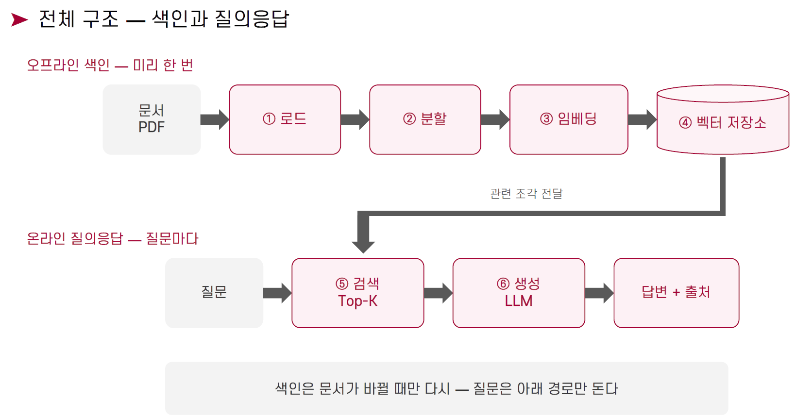

# 개인 맞춤형 정부 지원제도 탐색 및 안내 서비스 (RAG)

사용자가 생활 상황을 자연어로 질문하면(예: "서울에 사는 27살 취업준비생이 받을 수 있는 청년 지원 제도"), 공공데이터에서 해당 가능성이 있는 정부 지원제도를 찾아 **자격조건·신청 절차를 출처와 함께** 안내하는 RAG 서비스입니다. **청년 사용자를 대상으로 하며, 청년 전용 제도뿐 아니라 일반 개인·가구 지원제도도 안내합니다**([1.1](#11-데이터-범위--청년-사용자를-위한-개인가구-지원)).

- 설계 근거: [`docs/사전기획서.docx`](docs/사전기획서.docx) (1~9장)
- 상세 설계 이유·변경 이력: [`docs/ARCHITECTURE.md`](docs/ARCHITECTURE.md)
- AI 작업 지침(규칙 원문): [`CLAUDE.md`](CLAUDE.md)

> A의 수집·정제·SQLite·분할·증분 인계는 구현되어 있으며 오프라인 합성 테스트로 검증했습니다. 실제 API는 소량 표본을 확인했고 전체 적합성·자동 소실 권한은 미검증입니다. B의 색인·검색과 C의 근거 선별·답변 생성 경로도 구현되어 있습니다. 저장된 이벤트를 처리하는 인계 소비자는 실제 Chroma와 가짜 임베딩으로 검증했으며, 실제 모델과 운영 데이터의 통합 검증은 별도 확인이 필요합니다. 구현된 동작·필드 확인 수준·실행·B 인계는 [A 운영 계약](docs/INGEST_A.md)을 참고하세요.

2차 수정에서 과거 상세/현재 목록 병합, fixture 저장소 격리, HTML 표 경계를 보완했습니다.
격리된 라이브 표본은 세 엔드포인트 각각 3건을 확인했습니다. 전체 API 순회와 운영용 연령·지역 변환 어댑터는 아직 검증되지 않았습니다. 해당 인계 구현 단계에서 라이브 API나 실제 모델을 새로 검증한 것은 아닙니다.

## 1. 데이터

- 출처: 공공데이터포털 "행정안전부_대한민국 공공서비스(혜택) 정보"(보조금24) REST API (전체 약 1만 건 중 **일반 개인·가구 지원제도도 포함**하며, 실제 건수는 관측된 원본에 따라 달라짐)
- 서비스 1건 = 서비스명, 지원대상, 선정기준, 지원내용, 신청방법, 신청기한, 소관기관, 상세 링크 + 지원조건(정형)
- 원본 응답은 `data/raw/`에 저장하고 **커밋하지 않습니다**. API 키는 `.env`에만 두고 **커밋하지 않습니다**.
- 첨부 문서·이미지는 수집하지 않고 상세 링크로 대신합니다.

### 1.1 데이터 범위 — 청년 사용자를 위한 개인·가구 지원

서비스의 주 사용자는 청년입니다. 색인에는 청년 전용 제도뿐 아니라 고용·주거·교육·소득 및 생활안정·결혼·임신·출산·양육·돌봄 등 일반 개인·가구 지원제도도 포함합니다. 자녀나 부양가족을 통해 가구가 받을 수 있는 지원도 대상입니다.

데이터 포함 여부는 `ingest.policy.inclusion_decision()`에서 `personal-household-v1` 정책으로 판정합니다.

- `include`: 포함 근거가 있는 제도.
- `provisional`: 적용 가능성이 불명확하여 잠정 포함하는 제도.
- `exclude`: 지원대상이 기관으로만 명시된 제도.

청년 키워드가 없거나, 고령자·부양가족의 연령 또는 사업 관련 표현이 있다는 이유만으로 제외하지 않습니다. 적용 가능성이 모호하면 잠정 포함합니다. 청년 키워드와 검증된 신청자 연령 구간의 겹침은 설명용 태그로 남기며, `is_youth_service()`는 기존의 청년 태그 판정용 참·거짓 반환 동작을 유지합니다.

데이터 포함과 실제 신청 자격은 별개입니다. 자녀의 나이를 신청자의 나이로 채우거나, 확인되지 않은 JA 코드를 해석하지 않습니다. A는 기관명으로 거주지 자격을 추정하지 않으며, B가 색인 시 기관명에서 지역을 보충하는 것은 검색용 추정입니다. 값을 모른다고 해서 자격 제한이 없다는 뜻은 아닙니다.

제외된 기관 전용 레코드는 최소한의 감사 정보만 보존합니다. 과거 `youth_scope_exit`로 제외됐던 제도를 다시 검색 가능하게 하려면 사용할 수 있는 원본 본문이 필요합니다.

실행 방법은 [원본 재처리 안내](docs/INGEST_A.md#historical-raw-reprocessing-원본-재처리)를 참고하세요. `pipeline --full`은 API를 수집하고 활성 서비스의 조각을 다시 인계 대기열에 넣지만, 이전에 버린 본문까지 스스로 복구하지는 못합니다. 포함 판정기는 평가 정답을 읽거나 수정하지 않습니다.

## 2. 전체 구조 — 색인과 질의응답



색인은 데이터가 바뀔 때만 다시 돌리고, 질문은 온라인 경로만 돕니다.

**오프라인 색인** (데이터가 바뀔 때만)

| 단계 | 내용 | 코드 | 담당 |
|---|---|---|---|
| ① 로드 | API 수집·정제 → DB 적재 | `src/ingest/client.py`, `store.py` | A |
| ② 분할 | 항목별(지원대상/선정기준/지원내용/신청방법) 구조 기반 분할, 긴 항목은 Recursive 보조, 조각 앞에 서비스명 접두 | `src/ingest/chunker.py` | A |
| ③ 임베딩 | 로컬 다국어 모델(bge-m3 우선, 자원 부족 시 multilingual-e5) | `src/index/embedder.py` | B |
| ④ 벡터 저장소 | 조각 + 메타데이터(지역·소관기관·분야·신청기한·대상조건) 저장. Chroma(벡터) + BM25(글자 2-gram) | `src/index/vector_store.py` | B |

**온라인 질의응답** (질문마다)

| 단계 | 내용 | 코드 | 담당 |
|---|---|---|---|
| 조건 추출 | 질문 → LLM이 나이·거주지·상황·관심 분야 추출 | `src/generate/condition_extractor.py` | C |
| ⑤ 검색 | 정형 필터 + Hybrid(Vector + BM25), Top-5, 중복 제거 | `src/retrieve/hybrid.py`, `filters.py` | B |
| 근거 선별 | 조각을 서비스 단위로 묶어 3~5개 제도로 제한 | `src/generate/evidence.py` | C |
| ⑥ 생성 | gpt-4o-mini → 답변 + 출처 | `src/generate/generator.py`, `citation.py` | C |

구조도와 다른 점: 입력이 PDF가 아닌 API이고 정형 지원조건이 함께 들어옵니다 / 검색 앞에 조건 추출과 정형 필터가 있습니다 / 검색과 생성 사이에 근거 선별이 있습니다.

**데이터 흐름**
- 오프라인(기본 1일 1회 증분): `ingest.client` → `ingest.store`(정제·DB·변경 감지) → `ingest.chunker`(`Chunk`) → `index.embedder` → `index.vector_store`
- 온라인(질문마다): 질문 → `condition_extractor`(`Filters`) → `retrieve.hybrid.search`(필터 + Vector + BM25, 중복 제거, 필요 시 필터 완화) → `evidence.select_evidence` → `generator.generate_answer` + `citation` → `Answer`

### 2.1 단계별 입출력 예시

> 아직 구현 전이라 **예상 출력**입니다. 형식(키 이름·타입)은 `src/common/schema.py`와 같고, 수치·문구는 이해를 돕기 위한 예시입니다. 구현하면서 실제 출력으로 교체하세요.
> 예시 전체가 한 질문의 흐름을 따라갑니다: **"서울에 사는 27살 취업준비생인데 월세가 부담돼요. 받을 수 있는 지원이 있을까요?"**

#### ① 로드 — `python -m src.ingest.pipeline`

수집 → 정제 → DB 적재 순으로 진행합니다. 기본 반환은 신규·변경 및 이전 실행의 **미확인 pending 조각**입니다. 아래 로그는 초기 설계의 예상 예시이며 실제 수집 결과가 아닙니다. 현재 한국어 실행 요약과 완전성 판정은 [A 운영 계약](docs/INGEST_A.md)을 따릅니다.

```
[client] serviceList 수집 완료: 10,213건 (perPage=500, 21페이지)
[client] supportConditions 수집 완료: 10,198건
[client] 원본 저장: data/raw/serviceList.json, supportConditions.json
[store]  데이터 포함 정책: 포함 / 잠정 포함 / 기관 전용으로 명시된 제도 제외 (설명용 예시)
[store]  upsert: 신규 40 / 변경 12 / 변동 없음 1,798
[store]  종료 처리: 3건 (색인에서 제거 대상)
```

DB에 저장되는 서비스 1건(정제 결과 `dict`)은 다음과 같습니다.

```json
{
  "service_id": "SVC000123",
  "service_name": "청년월세 지원(서울)",
  "agency": "서울특별시",
  "field": "주거",
  "support_target": "서울에 거주하며 월세로 사는 만 19~34세 무주택 청년",
  "selection_criteria": "부모와 따로 거주하고 소득이 기준 이하인 경우 선정",
  "support_content": "월 월세의 일부를 일정 기간 지원",
  "how_to_apply": "복지포털에서 온라인 신청",
  "deadline": "2026-12-31",
  "age_min": 19, "age_max": 34, "region": "서울",
  "detail_url": "https://www.gov.kr/portal/rcvfvrSvc/dtlEx/SVC000123",
  "content_hash": "a3f9...c21"
}
```

- 위 DB JSON은 초기 설계 예시입니다. 실제 SQLite는 정규 payload·실행 이력·미확인 인계 세 테이블을 사용하고, 검증된 자격은 eligibility에 보존합니다. 정확한 계약은 [A 운영 계약](docs/INGEST_A.md)을 따릅니다.
- 신청기한이 상시·미정이면 `deadline`은 `null`입니다. 값을 알 수 없는 항목도 `null`로 두며(추측 금지), 이는 뒤에서 "확인 필요"로 이어집니다.

#### ② 분할 — `chunker.chunk_service(service)`

서비스 1건이 항목별 최대 4개의 `Chunk`가 됩니다. 조각 앞에 서비스명이 붙고, 긴 항목은 `-1`, `-2`로 더 쪼개집니다.

```
입력: service_id=SVC000123 (청년월세 지원(서울))
출력: 4개 Chunk
  SVC000123#지원대상  "청년월세 지원(서울)\n서울에 거주하며 월세로 사는 만 19~34세 무주택 청년"
  SVC000123#선정기준  "청년월세 지원(서울)\n부모와 따로 거주하고 소득이 기준 이하인 경우 선정"
  SVC000123#지원내용  "청년월세 지원(서울)\n월 월세의 일부를 일정 기간 지원"
  SVC000123#신청방법  "청년월세 지원(서울)\n복지포털에서 온라인 신청"
```

조각 1개는 아래 형태입니다 (A → B 인터페이스).

```json
{
  "chunk_id": "SVC000123#지원대상",
  "service_id": "SVC000123",
  "service_name": "청년월세 지원(서울)",
  "section": "지원대상",
  "text": "청년월세 지원(서울)\n서울에 거주하며 월세로 사는 만 19~34세 무주택 청년",
  "metadata": {"region": "서울", "agency": "서울특별시", "field": "주거",
               "deadline": "2026-12-31", "age_min": 19, "age_max": 34, "target_tags": ["청년"]},
  "detail_url": "https://www.gov.kr/portal/rcvfvrSvc/dtlEx/SVC000123"
}
```

데이터 건수는 관측한 원본 범위와 포함 정책 버전에 따라 달라집니다. 표본의 건수만으로 전체 데이터가 빠짐없이 포함됐다고 판단하지 않습니다.

#### ③ 임베딩 — `embedder.embed_texts(texts)`

텍스트 N개를 넣으면 같은 순서로 벡터 N개가 나옵니다. bge-m3 기준 벡터 차원은 1024입니다.

```
입력: ["청년월세 지원(서울)\n서울에 거주하며 ...", "청년월세 지원(서울)\n부모와 따로 ..."]
출력: [[0.012, -0.034, 0.101, ... (1024개)], [0.008, -0.029, 0.095, ...]]   # list[list[float]], 각 벡터는 길이 1로 정규화됨
```

- 질문은 `embed_query("월세가 부담돼요")`로 임베딩합니다(벡터 1개). `embed_texts(texts, kind="query")`와 같습니다.
- 벡터는 항상 길이 1로 정규화되므로 **내적 = 코사인 유사도**입니다. 벡터 저장소는 어느 쪽으로 검색해도 됩니다.
- multilingual-e5로 바꾸면 접두(`query: `/`passage: `)를 모듈이 알아서 붙입니다. 호출하는 쪽은 `kind`만 맞게 넘기면 됩니다.
- 모델은 처음 부를 때 한 번만 불러옵니다(첫 실행은 다운로드로 오래 걸림). `EMBEDDING_MODEL`, `EMBEDDING_DEVICE`, `EMBEDDING_BATCH_SIZE`는 `.env`/`config.py`에서 바꿉니다.

#### ④ 벡터 저장소 — `vector_store.build_index(chunks)` / 조회

색인은 조각을 `chunk_id` 기준으로 upsert하고, 조회는 `(Chunk, 점수)` 목록을 돌려줍니다. 점수는 벡터 검색이 코사인 유사도(높을수록 가까움), BM25 검색이 BM25 점수입니다.

```
[index] 조각 208개 색인 / 총 7,400개 (chunks__BAAI_bge-m3)

vector_search("월세가 부담돼요", k=3)
  → [(SVC000123#지원대상, 0.82), (SVC000456#지원대상, 0.80), (SVC000123#지원내용, 0.77)]
bm25_search("청년월세", k=3)
  → [(SVC000123#지원대상, 11.4), (SVC000456#지원대상, 10.9), (SVC000789#지원내용, 6.2)]
get_service_chunks("SVC000123")
  → 한 서비스의 지원대상·선정기준·지원내용·신청방법 조각 4개 (항목 순)
```

- **구성**: 벡터는 Chroma(`data/vectorstore/`에 저장, 커밋 안 함), 키워드는 `rank_bm25` + 글자 2-gram입니다. 한국어는 조사가 붙어("월세를") 단어 단위로 자르면 놓치고, 3글자 단위(trigram)는 두 글자 단어("월세")를 못 찾아서 2-gram을 씁니다.
- **소프트 필터를 저장소에서 처리**: 저장할 때 빈 값을 통과하는 값으로 바꿔 둡니다(지역 없음 `""`, 연령 하한 없음 `-1`, 상한 없음 `999`, 기한 없음 `99999999`). `build_where(filters)`가 이에 맞는 조건을 만들며, 기한 지난 제도는 항상 제외합니다. 필터 없이 검색하려면(Vector 단독 실험) `where=None`을 넘깁니다. 읽어 올 때는 빈 값을 다시 키 생략으로 되돌립니다.
- **증분 색인**: 같은 `chunk_id`는 덮어쓰고, 서비스에서 사라진 항목의 조각은 지우며, 종료된 서비스는 `remove_services`로 제거합니다. BM25 색인은 저장된 텍스트에서 자동으로 다시 만들어집니다(색인이 바뀌면 갱신).
- **모델별 컬렉션**: 임베딩 모델을 바꿔도 차원이 달라 깨지지 않도록 컬렉션 이름에 모델명이 들어갑니다. 모델을 바꾸면 다시 색인해야 합니다.
- **속도(참고)**: 이 샌드박스(4코어)에서 가짜 벡터 2만 조각으로 쟀을 때 색인 약 93초(임베딩 제외), 검색은 필터 포함 질의당 벡터 약 0.2초·BM25 약 0.26초, BM25 색인을 처음 만드는 데 약 10초였습니다. 조각이 수십만 개를 넘으면 BM25(메모리에 올림)가 병목이 되므로 그때는 Qdrant·Elasticsearch 등을 검토합니다.
- 확인: `python -m src.index.vector_store --sample --query "월세가 부담돼요"` (샘플 조각을 색인하고 벡터·BM25 결과를 출력)

#### 조건 추출 — `condition_extractor.extract_conditions(question)`

질문에서 찾은 항목만 담고, 없는 항목은 키를 생략합니다. `to_filters`가 B의 `Filters`로 바꿉니다.

```
입력: "서울에 사는 27살 취업준비생인데 월세가 부담돼요. 받을 수 있는 지원이 있을까요?"
출력: {"age": 27, "region": "서울", "situation": ["구직"], "field": "주거"}
Filters: {"age": 27, "region": "서울", "field": "주거", "situation": ["구직"], "today": "2026-10-19"}
         └ 나이·지역·기준일은 제도를 거르고, 분야(주거)는 맞는 제도를 앞으로 올리기만 하며(가산점), 상황(구직)은 지금 검색에 쓰이지 않음
```

#### ⑤ 검색 — `hybrid.search(query, filters, k=5)`

정형 필터 후 Vector + BM25 결과를 합쳐 **서비스당 조각 1개**로 줄인 `list[Chunk]`를 관련도 순으로 돌려줍니다.

```
python -m src.retrieve.hybrid "월세가 부담돼요" --age 27 --region 서울

[hybrid_filter] 필터: {'age': 27, 'region': '서울', 'today': '2026-10-19'}
 1.  0.0320  SVC000123  청년월세 지원(서울)   [지원내용]  서울
 2.  0.0164  SVC000456  구직촉진수당          [지원대상]  전국
 3.  0.0149  SVC000789  서울 청년수당         [선정기준]  서울
 4.  0.0137  SVC000321  주거급여              [지원대상]  전국
 5.  0.0130  SVC000654  국민내일배움카드      [지원내용]  -        ← 지역 값이 비어 있어 통과 (C가 "확인 필요"로 표시)
```

점수는 RRF 점수라 값이 작은 것이 정상입니다(1위가 두 검색 모두 1위면 약 0.033). 비교는 순서로 하세요.

- **합치는 방법(RRF)**: Vector와 BM25는 점수 단위(코사인 vs BM25)가 달라 점수를 더하지 않고 **순위**만 씁니다. 점수 = Σ 가중치 / (60 + 순위). 후보는 각 검색에서 50개씩 가져오고, 서비스 중복 제거 후 Top-K를 채웁니다. 상수와 가중치는 `config.RRF_K`, `HYBRID_CANDIDATES`, `HYBRID_WEIGHTS`에서 실험으로 조정합니다.
- **서비스당 1개**: 같은 제도의 조각은 가장 높은 것 하나만 남깁니다. 그렇지 않으면 Top-5가 한두 제도의 조각으로 채워집니다.
- **필터(소프트)**: 거르는 조건은 **신청기한·나이·지역** 세 가지입니다. 값이 비어 있는 제도는 통과, **신청기한이 지난 제도는 항상 제외**합니다. 저장소 안에서 `vector_store.build_where`로 거르고, 이미 꺼낸 목록은 `filters.apply_filters`로 거르며 두 규칙은 같습니다(테스트로 확인).
- **관심 분야(`field`)는 필터가 아니라 가산점**: 분야는 자격이 아니라 관심사라 거르지 않습니다. 분야가 제도의 분야와 맞으면(한쪽이 다른 쪽을 포함하면 맞음. 예: "주거"와 "주거·자립") RRF 점수에 `config.FIELD_BOOST`(기본 0.002)를 더해 앞으로 올릴 뿐이라, 질문에서 뽑은 분야 이름이 데이터와 달라도 제도가 사라지지 않고, 분야가 하나여도 다른 분야 제도(예: "월세 + 취업 준비" 질문의 구직 지원)가 후보에 남습니다. `FIELD_BOOST = 0`이면 끕니다. 상황(`situation`)은 지금 검색에 쓰이지 않습니다.
- **필터 완화**: 거르는 조건에 맞는 제도가 하나도 없을 때만 **지역 → 연령** 순으로 하나씩 풀어 다시 찾습니다(신청기한은 풀지 않음, 분야·상황은 필터가 아니라 풀 대상도 아님). 끝까지 없으면 빈 리스트이고, C는 이를 "근거 없음"으로 처리합니다. 완화 여부는 `hybrid.search_with_info(...)`가 돌려주는 `relaxed`, `filters_used`로 볼 수 있습니다(C가 "조건을 완화해 찾았다"고 안내할 때 쓸 수 있음).
- **`mode`(평가 실험용)**: `vector`·`bm25`·`hybrid`는 **필터를 쓰지 않고** 검색하고, `hybrid_filter`(서비스 기본값)만 필터와 완화를 적용합니다. 값은 코사인·BM25·RRF 점수입니다.
- 지역은 문자열이 정확히 같아야 합니다("서울" ≠ "서울특별시"). 지역명 정규화는 A가 메타데이터를 만들 때 맞춥니다.

#### 근거 선별 — `evidence.select_evidence(chunks)`

같은 서비스의 조각을 묶어 최대 5개 제도로 제한합니다. 키는 `service_id`입니다.

```
{
  "SVC000123": [지원대상 조각, 선정기준 조각, 지원내용 조각, 신청방법 조각],
  "SVC000456": [지원대상 조각, 선정기준 조각],
  "SVC000789": [선정기준 조각, 신청방법 조각],
  ...
}
```

#### ⑥ 생성 — `generator.answer_question(question)` → `Answer`

사용자에게 보이는 최종 결과입니다. 아래는 `Answer.text`의 모습입니다.

```
질문하신 상황(서울 거주, 27세, 구직 중, 월세 부담)에 해당할 수 있는 지원제도입니다.

1. 청년월세 지원(서울) — 서울특별시
   - 해당 가능 이유: 서울에 거주하는 만 19~34세 무주택 청년이 대상입니다.
   - 지원내용: 월 월세의 일부를 일정 기간 지원
   - 신청방법·기한: 복지포털 온라인 신청 / 2026-12-31까지
   - 확인 필요: 부모와 따로 거주하는지, 소득 기준 충족 여부
   - 근거: "서울에 거주하며 월세로 사는 만 19~34세 무주택 청년"
   - 상세 링크: https://www.gov.kr/portal/rcvfvrSvc/dtlEx/SVC000123

2. 구직촉진수당 — 고용노동부
   - 해당 가능 이유: 취업을 준비하는 저소득 구직자가 대상입니다.
   - 확인 필요: 가구 소득·재산 요건, 신청기한(정보 없음)
   ...

※ 최종 신청 자격은 담당 기관에서 확인하세요.
```

- 구조화된 결과는 `Answer.recommendations`(제도별 `Recommendation`)에, 근거는 각 `Recommendation.citations`에 들어 있어 UI가 따로 표시할 수 있습니다.
- 근거가 없는 질문(예: "내년에 새로 생길 예정인 청년 지원금은 어떻게 신청하나요?")은 추측하지 않고 `no_evidence=True`로 이렇게 답합니다.

```
수집된 자료에서 근거를 찾지 못했습니다. 담당 기관 또는 정부24 등 공식 사이트에서 확인해 주세요.
```

### 2.2 팀 간 인계 데이터 — A → B, C ↔ B

2.1의 예시 중 **사람과 사람 사이를 넘어가는 부분**만 따로 모았습니다. 두 곳 모두 같은 타입 `Chunk`(`src/common/schema.py`)를 주고받고, 달라지는 것은 **개수**(전체 vs 질문과 관련된 몇 개)입니다.

```
 A (src/ingest)                 B (src/index, src/retrieve)                 C (src/generate)
 ┌───────────────┐  list[Chunk]  ┌──────────────────────────┐  list[Chunk]  ┌───────────────────┐
 │ pipeline.run()│ ────────────▶ │ build_index(chunks)      │               │ answer_question() │
 │ 수만 개, 전부 │  (1) 색인용   │        ⋮                 │ ◀──────────── │  Filters          │
 └───────────────┘               │ search(query, filters)   │  (2) 필터     └───────────────────┘
                                 │                          │ ────────────▶          │
                                 └──────────────────────────┘  (3) Top-5, 이 질문에 맞는 것만
```

| | 누가 → 누구에게 | 무엇을 | 언제 | 개수 |
|---|---|---|---|---|
| (1) | A → B | `list[Chunk]` (`pipeline.run()`의 반환값) | 데이터가 바뀔 때(기본 1일 1회) | 신규·변경분 수백 ~ 전체 수만 개 |
| (2) | C → B | `Filters` (질문에서 뽑은 조건) | 질문마다 | 1개 |
| (3) | B → C | `list[Chunk]` (`search()`의 반환값) | 질문마다 | 최대 5개(서비스당 1개) |

#### (1) A → B: 색인용 조각

A는 서비스 전체 교체·제거 이벤트를 `pending_changes`에 저장합니다. `python -m src.ingest.handoff`로 미처리 이벤트를 확인하고, `--apply`를 지정하면 B의 기존 `build_index()`·`remove_services()`로 반영합니다. 영속 저장 문서와 Vector·BM25 양쪽 검색 경로를 검증한 뒤, 원래 이벤트의 `service_id + version + event_id` 토큰으로 확인 처리합니다. 저장된 이벤트를 `pipeline.run()`의 반환값이나 현재 서비스 레코드로 대체하지 않습니다. 자세한 내용은 [인계 계약](docs/INGEST_A.md#stored-event-consumer-증분-색인-인계-소비자)을 참고하세요.

```python
# A가 만들어서 넘긴다 — pipeline.run() 의 반환값 (일부)
[
  Chunk(chunk_id="SVC000123#지원대상", service_id="SVC000123", service_name="청년월세 지원(서울)",
        section="지원대상",
        text="청년월세 지원(서울)\n서울에 거주하며 월세로 사는 만 19~34세 무주택 청년",
        metadata={"region": "서울", "agency": "서울특별시", "field": "주거",
                  "deadline": "2026-12-31", "age_min": 19, "age_max": 34, "target_tags": ["청년"]},
        detail_url="https://www.gov.kr/portal/rcvfvrSvc/dtlEx/SVC000123"),
  Chunk(chunk_id="SVC000123#선정기준", ... 같은 서비스의 다른 항목 ...),
  Chunk(chunk_id="SVC000456#지원대상", service_id="SVC000456", service_name="구직촉진수당",
        section="지원대상", text="구직촉진수당\n취업을 준비하는 저소득 구직자",
        metadata={"agency": "고용노동부", "field": "일자리", "age_min": 15, "age_max": 69},  # region·deadline 없음 = 값이 비어 있음
        detail_url="https://www.gov.kr/portal/rcvfvrSvc/dtlEx/SVC000456"),
  ...
]
```

- **A가 보장할 것**: `chunk_id`는 전체에서 유일(`{service_id}#{section}`), `text` 맨 앞에 서비스명, `section`은 4개 항목 중 하나, 값을 모르는 `metadata` 키는 **생략**(추측해서 채우지 않음).
- **B가 가정해도 되는 것**: 위 규칙이 지켜진다는 점, 같은 `service_id`의 조각이 여러 개라는 점. 반대로 **가정하면 안 되는 것**: 모든 조각에 `region`·`deadline`·`age_min`이 있다는 점(비어 있으면 필터에서 제외하지 않고 통과시킴).
- 둘이 함께 확인하는 방법([B가 A 없이 테스트하기](#b가-a의-구현-없이-테스트하기)): A가 실제 조각 몇 건을 `tests/fixtures/sample_chunks.json`과 같은 형식으로 저장해 B에게 주면, B는 `python -m pytest`에서 그 파일로 바로 시험할 수 있습니다.

#### (2) C → B: 필터

C는 질문에서 뽑은 조건을 `Filters`로 바꿔서 B에게 줍니다. **값을 못 찾은 키는 생략**합니다.

```python
{"age": 27, "region": "서울", "field": "주거", "situation": ["구직"], "today": "2026-10-19"}
```

#### (3) B → C: 이 질문에 맞는 조각 Top-5

> B 없이 이 인계를 흉내 내서 C를 시험하는 방법은 [테스트](#c가-b의-구현-없이-테스트하기)를 보세요. 샘플은 `tests/fixtures/sample_search_results.json`입니다.

B가 C에게 주는 것은 **질문 한 건에 대해 필터·검색·중복 제거를 거친 조각 목록**입니다. 타입은 (1)과 같고, 서비스당 1개로 줄어 있습니다.

```python
# B: hybrid.search("월세가 부담돼요 ...", filters, k=5)  →  C가 받는 값
[
  Chunk(chunk_id="SVC000123#지원대상", service_name="청년월세 지원(서울)", section="지원대상",
        text="청년월세 지원(서울)\n서울에 거주하며 월세로 사는 만 19~34세 무주택 청년", ...),
  Chunk(chunk_id="SVC000456#지원대상", service_name="구직촉진수당", section="지원대상",
        text="구직촉진수당\n취업을 준비하는 저소득 구직자",
        metadata={"agency": "고용노동부", "field": "일자리", "age_min": 15, "age_max": 69}, ...),  # region·deadline 없음
  Chunk(chunk_id="SVC000789#선정기준", service_name="서울 청년수당", section="선정기준", ...),
  Chunk(chunk_id="SVC000321#지원대상", service_name="주거급여", section="지원대상", ...),
  Chunk(chunk_id="SVC000654#지원내용", service_name="국민내일배움카드", section="지원내용", ...),
]   # 관련도 높은 순
```

- **B가 보장할 것**: 순서는 관련도 순, 같은 서비스의 조각은 중복 제거, 신청기한이 지난 제도는 없음, 결과가 없으면 필터를 풀어 다시 검색한 뒤 돌려줌(그래도 없으면 빈 리스트).
- **초기 C 계약의 미해결 기대값**: 모든 조각의 기관·상세 링크가 비어 있지 않다는 기대와 달리 원천에 누락이 있을 수 있습니다. A는 값을 만들지 않고 metadata 키 생략/빈 detail_url 및 품질 진단으로 표시합니다. 공용 타입과 C 코드는 유지했으며 누락 표시·후보 제외 방침은 팀 결정이 필요합니다. region·deadline 등 미상 조건은 기존처럼 "확인 필요" 대상입니다. 이 제안은 팀 합의 완료를 의미하지 않습니다.
- C는 이 목록에서 같은 서비스의 다른 항목(선정기준, 신청방법 등)이 더 필요하면 `service_id`로 조각을 더 요청하거나 DB를 조회해야 합니다. 어느 쪽으로 할지는 B·C가 합의해서 정합니다. (근거 선별 단계가 이 문제를 다룹니다.)

> 형식이나 보장 사항을 바꾸고 싶으면 `src/common/schema.py`와 이 절을 먼저 고치고 상대 담당자와 합의하세요.

### 2.3 증분 색인 인계

```powershell
# 기존 원본 DB의 미처리 이벤트 확인 (모델·색인 초기화 없음)
.\.venv\Scripts\python.exe -m src.ingest.handoff --dry-run
# 이미 캐시된 일치 모델로 연결된 색인에 반영·검증·확인 처리
.\.venv\Scripts\python.exe -m src.ingest.handoff --apply
# 데이터가 있는 기존 B 컬렉션을 처음 연결할 때는 명시적으로 채택
.\.venv\Scripts\python.exe -m src.ingest.handoff --apply --adopt-existing
# 실패 원인을 해결한 뒤 같은 --apply 명령으로 재시도 (미처리 이벤트는 보존됨)
```

원본 DB 하나는 색인 디렉터리·모델 설정 하나에 연결됩니다. 작업 프로세스는 색인 → 원본 DB 순서로 운영체제 파일 잠금을 획득하며, 지원되는 수집·갱신·실행 반영 경로도 같은 DB 잠금을 사용합니다. 잠금을 다른 프로세스가 사용 중이면 즉시 실패합니다. 반영 중 첫 오류가 발생하면 종료 코드 1로 중단합니다. 앞서 검증·확인 처리한 이벤트는 완료 상태를 유지하고, 실패한 이벤트와 이후 이벤트는 대기열에 남습니다. BM25는 Chroma 문서에서 재생성하고 B의 `index_version`으로 갱신하므로, 별도의 영속 BM25 DB를 만들지 않습니다.

테스트용 샘플 원본을 적용할 때는 `--validation`과 격리된 `--db-path`·`--index-dir`를 명시해야 합니다. 보호된 운영 경로나 같은 위치를 가리키는 별칭은 쓰기 전에 거부합니다. 자세한 내용은 [격리 실행 명령과 동시 실행 제약](docs/INGEST_A.md#stored-event-consumer-증분-색인-인계-소비자)을 참고하세요. 기존 `src.index.vector_store` 직접 실행 CLI는 이 잠금 절차를 우회하므로 수집·인계 소비자와 동시에 실행하지 마세요. 해당 CLI는 pending 이벤트를 확인 처리하지 않습니다.

## 3. 디렉터리 구조와 담당

```
src/
  common/    config.py, schema.py                                  # 전원 공용: 설정, 모듈 간 데이터 계약
  ingest/    client, normalize, merge, storage, store, chunker, pipeline, locking, handoff* # A
  index/     embedder, vector_store                                # B
  retrieve/  hybrid, filters, baseline                             # B
  generate/  condition_extractor, evidence, generator, citation    # C
app/         main.py                                               # C: UI
eval/        metrics, answer_eval, run_eval, label_helper(정답 채우기 도구), questions.jsonl, results/
tests/       fixtures/(가상 샘플 조각·질의·검색 결과), conftest.py(fake_search 등), test_*.py
data/raw/    원본 응답 (커밋 금지)
docs/        사전기획서.docx, ARCHITECTURE.md, LABELING.md(정답 채우기 안내), images/
```

| 담당 | 맡은 단계 | 디렉터리 |
|---|---|---|
| A (데이터·색인) 담당자: | ① 로드, ② 분할, 메타데이터 설계, 정기 수집 | `src/ingest/` |
| B (임베딩·검색) 담당자: | ③ 임베딩, ④ 벡터 저장소, ⑤ 검색, 정형 필터, Baseline, 검색 평가 | `src/index/`, `src/retrieve/`, `eval/metrics.py`·`eval/run_eval.py` |
| C (생성·서비스) 담당자: | 조건 추출, 근거 선별, ⑥ 생성, 인용 형식, UI, 답변 평가 | `src/generate/`, `app/`, `eval/answer_eval.py` |

담당자 이름은 팀에서 채웁니다. 평가 질문 세트(`eval/questions.jsonl`)와 기획서 8.3 기술 선택 기록은 전원이 함께 작성합니다.

## 4. 모듈 간 인터페이스

팀 합의 후 확정합니다. 바꿀 때는 `CLAUDE.md`와 이 문서부터 고치고, 타입은 모두 `src/common/schema.py`에 있습니다.

- **A → B**: 조각 `Chunk{chunk_id, service_id, service_name, section, text, metadata, detail_url}`
  - `metadata`: 지역, 소관기관, 분야, 신청기한, 연령 범위, 대상 태그
- **C → B**: `Filters` (나이·지역·분야·상황·기준일, 값이 없으면 키 생략). **거르는 것은 나이·지역·기준일**이고, 분야는 맞는 제도에 가산점만 주며 상황은 현재 검색에 쓰이지 않습니다
- **B → C**: `search(query, filters, k=5, mode="hybrid_filter") -> list[Chunk]` (`mode`는 평가 실험용, 서비스는 기본값 사용)
- **C → 사용자**: `Answer` = 답변 텍스트 + 제도별 `Recommendation`(해당 가능 이유, 지원내용, 신청방법·기한, 확인 필요 조건, 근거 목록[서비스명·소관기관·근거 문구·상세 링크]) + `no_evidence`

## 5. 답변 생성 규칙

- 검색된 근거 안에서만 답합니다. 근거가 없으면 모른다고 답하고 담당 기관·공식 사이트 확인을 안내합니다.
- 자격이 불명확하거나 정형 조건 값이 비어 있으면 단정하지 않고 "확인 필요"로 표시합니다.
- 모든 답변에 서비스명·소관기관·근거 문구·상세 링크를 붙이고, "최종 신청 자격은 담당 기관에서 확인" 안내를 넣습니다.
- 신청기한이 지난 제도는 후보에서 제외합니다. 정형 필터는 하드가 아니라 소프트로 적용하고, 결과가 없으면 필터를 풀어 다시 검색합니다.
- 사용자에게 보이는 문구는 한국어로 작성합니다.

## 6. 설계 결정과 이유

| 결정 | 이유 |
|---|---|
| 디렉터리 = 담당자 단위 | 한 사람이 자기 폴더만 수정해 파일 충돌과 책임 논쟁을 없앤다. |
| `schema.py`에 모듈 간 계약을 한 곳에 정의 | 구현 전에도 서로의 입출력을 가정하고 병렬 개발한다. |
| A/B/C의 기존 공개 인터페이스 유지 | 저장된 이벤트 처리·잠금 절차·재시도 동작은 [A 운영 계약](docs/INGEST_A.md)에 기록합니다. |
| 증분 수집(`store.upsert_services`가 변경분 반환), 종료 서비스는 색인에서 제거 | 기획서 7장: 정기 수집 후 변경분만 재색인. |
| 구조 기반 분할 + 서비스명 접두 | 선정기준이 길어 한 덩어리로 임베딩하면 핵심 조건이 희석되고, 접두가 없으면 어느 제도의 조각인지 잃는다. |
| 소프트 필터 + `relax()` | 값이 비어 있으면 제외하지 않고, 결과가 없으면 필터를 풀어 재검색한다. |
| Hybrid는 RRF(순위 합산)로 합치고 서비스당 조각 1개로 줄임, 결과가 없으면 지역→연령 순으로 완화 | 점수 단위가 다른 두 검색을 순위로 합치면 튜닝이 거의 필요 없다. 서비스 단위로 줄여야 Top-5가 서로 다른 제도 5개가 된다. 완화 순서는 덜 중요한 조건부터이며 신청기한은 풀지 않는다(종료된 제도를 보여주면 안 됨). |
| 관심 분야는 필터가 아니라 가산점 (`FIELD_BOOST`) | 분야는 자격이 아니라 관심사이고, 질문에서 뽑은 분야 이름이 데이터의 서비스분야와 달라도(예: "주거" vs "주거·자립") 제도가 사라지지 않아야 한다. 화면 테스트에서 분야가 "주거" 하나로 뽑히자 구직 지원 제도가 통째로 걸러지는 문제가 발견되어 B·C 합의로 바꿨다. |
| 벡터 저장소는 Chroma, 소프트 필터는 저장할 때 빈 값을 대체값으로 바꿔 처리 | 일반 개인·가구 지원으로 범위가 확대되어 정식 벡터 DB를 쓴다. Chroma는 "값이 없으면 통과"를 쿼리로 표현하기 어려워, 색인 시 빈 값을 통과하는 값으로 저장해 해결했다. |
| BM25는 `rank_bm25` + 글자 2-gram, 색인은 저장된 텍스트에서 자동 재생성 | 한국어 조사·두 글자 단어를 다루면서 추가 설치(형태소 분석기)가 필요 없다. Chroma에 BM25가 없어 따로 두되, 색인 버전 파일로 동기화한다. 부족하면 `kiwipiepy`로 교체하고 Baseline 실험에서 비교한다. |
| `retrieve/baseline.py`(질문→키워드→`store.sql_keyword_search`→키워드 종류 수로 순위, 서비스명 가중, 필터 없음), `search(mode=...)` | Baseline → Vector → Hybrid → Hybrid+필터 비교 실험으로 하이브리드 효과를 검증한다. `mode` 기본값이 서비스 경로라 시그니처는 호환된다. |
| `evidence.py`(근거 선별), `Answer`에 `no_evidence` | 질문당 제도를 3~5개로 제한하고, 근거 없음 응답을 UI·평가가 구분해 쓴다. |
| `app/`은 `answer_question()` 하나만 호출 | UI 교체와 백엔드 수정이 서로 영향을 주지 않는다. |
| 평가 채점 단위는 `service_id` | 분할 방식이 바뀌어도 질문 세트를 재사용한다. |

검색 난점별 대응 위치(기획서 7.1)와 결정별 상세 근거는 [`docs/ARCHITECTURE.md`](docs/ARCHITECTURE.md)를 봅니다.

## 7. 평가

- 검색: Hit Rate@K, Recall@K, MRR. 잠정 목표 Top-5 기준 Hit Rate 0.80, Recall 0.70, MRR 0.60 (`eval/metrics.TARGETS`)
  - **Hit Rate@K**: 정답이 하나라도 상위 K개 안에 있는 질문의 비율 / **Recall@K**: 질문별 (상위 K개 안의 정답 수 ÷ 전체 정답 수)의 평균 / **MRR**: 질문별 1 ÷ (첫 정답의 순위)의 평균 (정답이 없으면 0)
  - 채점 단위는 조각이 아니라 `service_id`입니다. `hybrid.search`가 이미 서비스당 1개로 줄여 주므로 결과의 `service_id`를 순서대로 넣으면 됩니다.
  - 정답이 없는 질문(`expect_no_answer`)은 검색 지표에서 **제외**하고(분모에 안 넣음), 대신 `no_evidence_rate`로 따로 봅니다(그런 질문에서 검색이 빈 결과를 돌려준 비율. 관련도 하한선을 정할 때 쓸 지표).
  - 확인: `python -m eval.metrics`(손으로 계산한 예시와 일치하는지 출력)와 `python -m pytest tests/test_metrics.py`
  - 사용: `evaluate(retrieved, relevant)`가 K=3·5·10 지표를 한 번에 계산하고 `check_targets(...)`가 잠정 목표 달성 여부를 알려 줍니다. 예: 두 질문의 결과가 `[["a","b","c"], ["x","a"]]`, 정답이 `[{"b"}, {"a"}]`이면 Hit Rate@3 = 1.0, MRR = (1/2 + 1/2) ÷ 2 = 0.5.
- 답변: Answer Correctness, Faithfulness, Citation Accuracy
- 실험 순서: Baseline(SQL+키워드) → Vector → BM25 → Hybrid → Hybrid+정형 필터 → 최종. 결과는 `eval/results/`에 저장하고 요약을 기획서 9.4에 기록합니다. Top-K는 3 / 5 / 10을 비교합니다.
- 질문 세트: `eval/questions.jsonl` (현재 36문항(상황형 중심 34 + 지역 후속 2), **청년 상황형 질문 중심** — 1.1 참고). 한 줄에 한 질문(JSON)이며 필드는 다음과 같습니다.

  | 필드 | 설명 |
  |---|---|
  | `id`, `category`, `question` | 식별자, 범주(상황형·제도명 아는 질문·지역·연령 조건·근거 없음 등), 질문 |
  | `topic` (선택) | 사람이 보는 주제 분류(구직·주거·교육·금융·결혼·출산·양육·창업·건강·교통·자립 등). 약한 주제를 찾는 용도이며 평가 계산에는 쓰이지 않음 |
  | `relevant_service_ids` | 정답 `service_id` 목록 (보조금24 서비스ID). 팀원이 데이터를 읽고 `eval/label_helper.py`로 채움 |
  | `relevant_service_names` (자동) | 정답 제도 이름. 도구가 정답과 함께 적어 두며 사람이 검수하기 위한 값 (평가 계산에는 안 쓰임) |
  | `label_source`·`reviewed`·`label_confidence`·`label_note` (자동) | 정답을 Claude가 1차로 채웠을 때의 출처·사람 검수 여부·신뢰도·근거 (LABELING.md §8.2.1). 평가 계산에는 안 쓰임 |
  | `follow_up_of` (자동) | `followup` 명령으로 만든 후속 문항이 어느 질문에서 왔는지 |
  | `expected_answer` | 기대하는 답변(사람이 읽는 설명, 답변 평가용) |
  | `expect_no_answer` | 근거가 없어 "모른다"고 답해야 하는 질문이면 `true` |
  | `filters` (선택) | 이 질문의 정형 조건. LLM 조건 추출과 분리해서 검색만 평가하려고 정답 조건을 직접 적음. 예: `{"age": 27, "region": "서울"}` (`hybrid_filter` 실험에서만 사용) |
  | `todo` (선택) | 정답을 아직 못 정한 항목의 메모 |

  질문은 세 종류로 나뉩니다: **평가 대상**(정답 있음 → Hit Rate·Recall·MRR 계산), **근거 없음**(`expect_no_answer` → 검색 지표에서 제외, `no_evidence_rate`로 따로 봄), **정답 미지정**(정답도 `expect_no_answer`도 없음 → 제외하고 몇 개인지 경고).

#### 질문 초안 (34문항)

`eval/questions.jsonl`에는 **정답을 비워 둔 초안 34문항**이 들어 있습니다. 기획서 9.1(생활 변화별 상황형 중심, 제도명을 아는 질문, 지역·연령, 기한 지난 제도, 근거 없음)에 맞춰 구성했습니다.

| 범주 | 문항 수 | 내용 |
|---|---|---|
| 상황형 | 22 | 구직·직업훈련·주거(월세·보증금·자취)·교육(등록금·학자금)·금융(저축·대출·채무)·결혼·출산·양육·창업·건강·교통·자립. 제도명을 모르고 생활 상황으로 묻는 질문 |
| 제도명 아는 질문 | 4 | 근로장려금, 국민취업지원제도, 청년도약계좌, 국민내일배움카드 |
| 지역·연령 조건 | 3 | 서울 27세, 경기 25세, 부산 33세 (`filters`에 조건 기재) |
| 기한 지난 제도 | 2 | 신청이 끝난 제도를 물었을 때 후보에서 제외되는지 |
| 근거 없음 | 3 | 아직 없는 제도, 청년 범위 밖(기초연금), 존재하지 않는 제도 |

- **정답은 모두 비어 있습니다.** 수집된 데이터에 이 제도들이 실제로 있는지 모르기 때문에, 데이터가 들어온 뒤 팀원이 **데이터를 직접 읽고** 채웁니다.
  데이터에 없는 제도·상황이면 질문을 바꾸거나 삭제합니다(기획서 9.1의 메모와 같음). 제도명 질문과 기한 지난 제도 질문의 실제 제도명은 예시이므로 데이터에 있는 제도로 교체해도 됩니다.
- `expected_answer`는 정답 서비스를 모르는 상태에서 쓴 **일반적인 기대 답변 설명**입니다. `todo`가 남은 질문은 평가에서 제외되므로 채울수록 평가 대상이 늘어납니다.
- 팀원이 문항을 나눠 채웁니다 (분담 제안은 [`docs/LABELING.md`](docs/LABELING.md) §9.1).

#### 정답 채우는 법 — 요약 (전체 안내: [`docs/LABELING.md`](docs/LABELING.md))

정답 채우기 전용 도구 `eval/label_helper.py`가 있습니다. 보조금24 서비스 목록을 내려받아 키워드로 찾아보고, **사람이 읽고 판단해서** 고른 `서비스ID`를 질문에 기록합니다.

```bash
python -m eval.label_helper fetch                  # 서비스 목록 내려받기 (한 번만, .env의 GOV24_API_KEY 필요)
python -m eval.label_helper status                 # 진행 상황
python -m eval.label_helper label --only q01,q02   # 내 담당 문항을 대화형으로 채우기 (한 문항씩 저장)
python -m eval.label_helper followup q01 --region 서울   # 지역을 알려 준 뒤의 후속 질문 문항 만들기
python -m eval.label_helper check                  # 정답 id·이름·지역·기한 검증 (오류 0건이 되게)
python -m eval.label_helper review                 # Claude가 1차로 채운 정답의 사람 검수 대기 목록 (--ok q01,q02 로 완료 표시)
```

정답 기준 (자세한 이유와 예외는 LABELING.md §3):
- **그 제도 하나만으로도 좋은 답이 되는** 제도만, 한 질문에 **5개 이내** (정답이 많으면 Recall이 구조적으로 낮아짐).
- 질문에 나오지 않은 소득·가구 조건은 따지지 않고(답변 단계의 "확인 필요"), **신청기한이 지난 제도는 제외하되, 청년이라는 표현이 없다는 이유만으로 제외하지 않습니다**.
- **지역이 없는 질문의 정답은 전국 단위 제도**입니다. 실제 서비스는 지역을 추가 질문으로 받기 때문에, 지역 제도는 `followup`으로 만든 별도 문항("서울에 살아요. …")에서 채웁니다.
- 복합 질문("월세 + 취업 준비")은 필요마다 따로 검색해 각각 2~3개.
- **우리 검색 시스템의 결과를 정답으로 베끼지 않습니다** (검색이 맞춘 것만 정답이 되어 점수가 부풀려짐).
- 근거 없음 질문은 키워드를 바꿔 3번 이상 찾아도 없을 때만 `none`/`keep`.

### 7.1 검색 평가 실행 — `python -m eval.run_eval`

```
python -m eval.run_eval --experiment hybrid_filter --k 5
python -m eval.sweep                                   # Hybrid 가중치·RRF_K·FIELD_BOOST 탐색 (MRR 순 표). --local-penalty 0,0.002,1 로 지역 제도 감점 실험 (현재 기본값: BM25 0.2, 지역 감점 1.0)
python -m eval.run_eval --experiment all --today 2026-10-19       # 전체 비교표 (재현하려면 --today 고정)
```

사전 조건: 색인이 있어야 하고(`python -m src.index.vector_store ...`), 질문 세트에 정답이 채워져 있어야 합니다. 정답이 하나도 없으면 "정답이 지정된 질문이 없습니다"라고 알려 주고 멈춥니다(실제 데이터가 들어오기 전에는 정상).

**실제 데이터 전에 시험해 보기**: 샘플 색인과 샘플 질문(`tests/fixtures/sample_eval_questions.jsonl`, 정답이 샘플 `service_id`로 지정됨)으로 스크립트가 도는지 확인할 수 있습니다.

```
python -m src.index.vector_store --sample --full
python -m eval.run_eval --experiment all --questions tests/fixtures/sample_eval_questions.jsonl --today 2026-10-19 --no-save
```

**실제 질문 세트의 정답 채우는 법**은 위 "정답 채우는 법"과 [`docs/LABELING.md`](docs/LABELING.md)를 보세요. `baseline`은 A의 SQLite 저장소(`data/services.db`, `python -m src.ingest.pipeline`로 생성)가 있어야 하며, 없으면 `all`에서 건너뜁니다. 키워드 추출은 조사만 떼는 단순 방식이고 정형 필터는 쓰지 않습니다.

출력 예 (예상 형식, 수치는 예시):

```
=== hybrid_filter  (K=5, 평가 28문항 / 근거 없음 3 / 정답 미지정 2) ===
  K=3   Hit Rate 0.786   Recall 0.690
  K=5   Hit Rate 0.857   Recall 0.744
  K=10  Hit Rate 0.929   Recall 0.821
  MRR   0.671
  잠정 목표(Top-5): hit_rate@5 달성(목표 0.80), recall@5 달성(목표 0.70), mrr 달성(목표 0.60)
  근거 없음 질문에서 빈 결과를 돌려준 비율: 0.33  (높을수록 좋음)
  ! 정답 미지정 2문항은 평가에서 제외됨: q29, q30
  범주별:
    상황형            n=14  Hit@5 0.86  Recall@5 0.71  MRR 0.65
    제도명 아는 질문  n=8   Hit@5 1.00  Recall@5 1.00  MRR 0.88
  Top-5에서 놓친 질문 4개:
    [q07] 월세가 부담되고 취업을 준비...  정답 ['SVC000123'] → 7위; 검색 SVC000456, SVC000789, ...
```

- **한 번에 K=3·5·10**을 계산합니다. 질문마다 가장 큰 K(10)만큼 가져오므로 `--k`는 표에서 강조할 K입니다.
- **놓친 질문 목록**이 핵심입니다. 정답이 몇 위였는지와 실제로 검색된 제도를 보여 줘서 원인(분할·필터·임베딩·BM25)을 찾는 출발점이 됩니다.
- **범주별 표**로 어떤 종류의 질문이 약한지 봅니다.
- `--experiment all`은 마지막에 **기획서 9.4에 옮겨 적을 마크다운 비교표**를 출력합니다.
- 결과는 `eval/results/<실험>_k<K>_<날짜-시각>.json`에 저장됩니다(설정·질문별 검색 결과·적용된 필터 포함). 9.4에 기록한 결과만 커밋하고 나머지는 올리지 않는 것을 권장합니다. `--no-save`로 저장을 끌 수 있습니다.
- `--today`를 주면 신청기한 기준일이 고정되어 같은 데이터에서 결과가 재현됩니다.
- 답변 평가(Answer Correctness·Faithfulness·Citation Accuracy)는 C가 `eval/answer_eval.py`와 연결합니다.

## 8. 시작하기

```bash
pip install -r requirements.txt        # 설치
cp .env.example .env                   # 키 입력: GOV24_API_KEY(Decoding 키), OPENAI_API_KEY
python -m src.ingest.pipeline          # A: 실제 수집, 기본 증분 (라이브 실행 전 승인)
python -m src.ingest.pipeline --full   # A: 활성 조각 재생성, DB·이력·pending 보존
python -m src.ingest.pipeline --offline-fixture tests/fixtures/a_synthetic_api.json  # 별도 저장소 강제
python -m src.ingest.pipeline --validation --sample-pages 1 --per-page 3  # 승인된 격리 라이브 표본
python -m pytest tests/ingest -q -ra   # A: 네트워크·키 없이 검증
python -m src.ingest.handoff --dry-run # A→B: 저장된 미처리 이벤트 확인 (--apply로 반영·검증·확인 처리)
python -m src.index.vector_store       # B: 기존 직접 색인 CLI (pending 확인 처리·소비자 잠금 없음)
python -m app.main                     # C: 앱 실행
python -m pytest -rs                   # 테스트
python -m eval.run_eval --experiment hybrid_filter --k 5   # 검색 평가 (baseline|vector|bm25|hybrid|hybrid_filter|all). all은 비교표까지 출력
python -m eval.label_helper label --only q01,q02   # 평가 질문 정답 채우기 (docs/LABELING.md)
```

모델 다운로드 시 나오는 `Warning: You are sending unauthenticated requests to the HF Hub` 경고는 무시해도 됩니다. 없애려면 `.env`에 `HF_TOKEN=<Hugging Face 토큰>`을 넣거나(다운로드도 빨라짐), 모델을 이미 받은 뒤라면 `HF_HUB_OFFLINE=1`을 넣으세요(`.env.example` 참고).

Windows PowerShell에서 환경변수를 직접 설정한다면 `export` 대신 `$env:GOV24_API_KEY="키"`를 씁니다.

### 테스트

앞 담당자의 구현이 끝나기 전에도 뒤 담당자가 자기 코드를 시험할 수 있도록, 인계 지점마다 `tests/fixtures/`에 **가상 샘플 데이터**를 두었습니다. 실제 제도 내용이 아니며, 실제 출력이 나오면 일부를 교체합니다.

| 누가 시험하나 | 앞 단계가 없을 때 대신 쓰는 것 | 샘플 파일 |
|---|---|---|
| B (A 없이) | 가짜 조각 `Chunk` 48개 | `sample_chunks.json`, `sample_queries.json` |
| C (B 없이) | 가짜 검색 결과 + 가짜 조건 추출 | `sample_search_results.json`, `fake_search`·`fake_conditions` 픽스처 |

기존 공용 테스트 훅은 `NotImplementedError`를 skip(건너뜀)으로 바꾸지만, A 전용 훅은 실패로 처리합니다. 인계 소비자 회귀 테스트는 skip 없이 통과해야 합니다. A 전용 `tests/ingest/`는 미구현을 실패로 처리하며 HTTP·SQLite를 격리합니다. 전체는 `python -m pytest -rs`, A는 `python -m pytest tests/ingest -q -ra`로 실행합니다. A 합성 응답은 `tests/fixtures/a_synthetic_api.json`이고 기존 B/C fixtures는 보존합니다.

#### B가 A의 구현 없이 테스트하기

A의 구현이 끝나기 전에도 B가 자기 코드를 검증할 수 있도록 가상 샘플 조각(12개 제도 × 4항목 = 48개)과 샘플 질의를 두었습니다.

- 지역만 다른 중복 제도, 기한 지난 제도, 값이 빈 제도, 제도명 정확 일치 대상이 섞여 있습니다.
- 시험 대상: `filters`(소프트 필터·기한 제외·완화), `metrics`(지표 계산), `vector_store`·`hybrid`(색인 후 검색 기대값). 테스트 파일은 `test_filters.py`, `test_metrics.py`, `test_retrieval.py`입니다.
- 검색 테스트는 격리된 `tmp_vectorstore`를 사용합니다. 인계 소비자 테스트는 가짜 임베딩과 실제 Chroma·BM25를 사용해 프로세스 간 잠금, 실패 후 재시도, C의 서비스 전체 근거 확장을 검증합니다.

#### C가 B의 구현 없이 테스트하기

B의 구현(색인·검색)이 끝나기 전에도 C가 자기 코드를 검증할 수 있도록, **B가 C에게 줄 검색 결과**를 미리 정해 둔 샘플(`sample_search_results.json`)을 두었습니다. 2.2의 (3) B → C 인계 데이터와 같은 모양입니다.

| 사례 | 질문 | B가 줬다고 가정하는 결과 | 확인하려는 것 |
|---|---|---|---|
| `sr1` | "서울에 사는 27살 취업준비생인데 월세가 부담돼요…" | 조각 5개(서비스당 1개, 관련도 순). 그중 `SAMPLE011`은 지역·연령 값이 비어 있음 | 근거 선별, 인용, 값이 빈 제도의 "확인 필요" 표시, 면책 문구 |
| `sr2` | "내년에 새로 생길 예정인 청년 지원금은…" | 빈 리스트 | 근거 없음 → 추측하지 않고 모른다고 답함 (`no_evidence=True`) |

C가 쓰는 도구는 두 가지입니다 (`tests/conftest.py`).

```python
def test_예시(fake_search, fake_conditions):
    case = fake_search("sr1")          # hybrid.search를 sr1의 가짜 결과로 바꾼다 (B 없이)
    fake_conditions(case)              # extract_conditions도 고정한다 (LLM 없이)
    answer = generator.answer_question(case["question"])
    assert case["calls"][0]["filters"]["region"] == "서울"   # C가 B에게 넘긴 필터를 확인할 수 있다
```

- **시험 대상**: `condition_extractor.to_filters`, `evidence.select_evidence`(3~5개 제도로 제한), `citation.build_citations`(서비스명·소관기관·근거 문구·링크), `generator`(근거 없음 응답, 전체 흐름). 테스트 파일은 `test_generate.py`입니다.
- **LLM 없이 되는 것**: 조건→필터 변환, 근거 선별, 인용, 근거 없음 응답(LLM을 부르지 않는 경로). **LLM이 필요한 것**: 실제 답변 생성은 `OPENAI_API_KEY`가 없으면 skip됩니다.
- **지켜야 할 코드 규칙**: 가짜로 바꿔 끼울 수 있도록, C는 다른 모듈의 함수를 `hybrid.search(...)`, `condition_extractor.extract_conditions(...)`처럼 **모듈 속성으로 호출**합니다. `from src.retrieve.hybrid import search`처럼 이름만 가져오면 가짜가 적용되지 않습니다.
- B의 실제 결과가 나오면 `sample_search_results.json`의 `result_chunk_ids`를 실제 검색 결과로 교체하고, B가 보장하는 규칙(서비스당 1개, 최대 5개, 기한 지난 제도 없음)이 지켜지는지 함께 확인합니다.

## 9. 작업 규칙

- 자기 담당 디렉터리 밖의 파일을 고칠 때는 담당자와 먼저 합의합니다.
- 변경 전에 `docs/사전기획서.docx`의 해당 절을 확인하고, 설계가 바뀌면 기획서(8.3)에도 기록합니다.
- 새 라이브러리를 추가하면 `requirements.txt`를 함께 갱신합니다.
- **문서 동기화**: 디렉터리·모듈·함수 시그니처·데이터 계약·담당 영역·명령을 바꾸면 같은 커밋에서 `README.md`, `docs/ARCHITECTURE.md`, `CLAUDE.md`의 해당 부분을 함께 갱신합니다.

## 10. 구현 현황

| 모듈 | 상태 |
|---|---|
| `src/ingest/` | 수집·정제·SQLite·분할·pending·CLI 구현. OAS·첫 페이지 표본 확인, 실제 연령/지역 어댑터·전체 적합성 미검증, 자동 소실 차단 |
| `src/common/config.py`, `src/common/schema.py`, `eval/run_eval.load_questions` | 구현됨 |
| `eval/sweep.py` | 구현됨 (B). Hybrid 매개변수 격자 탐색, 후보 캐시. 가짜 임베딩 색인으로 테스트(`tests/test_sweep.py`). 실제 색인 결과는 사용자가 실행해 확인 |
| `eval/label_helper.py` | 구현됨 (B). 질문 정답 채우기 도구(검색·전국/지역 구분·기한 경고·대화형·후속 질문·검증). 가짜 데이터로 테스트(`tests/test_label_helper.py`). 실제 API 응답으로는 미확인 (`fields` 명령으로 필드 확인 필요) |
| `tests/ingest/` | A 전용 mock HTTP·임시 DB·가짜 소비자·CLI 테스트. 미구현은 실패 처리 |
| 기존 B/C 테스트 | 구현 전(또는 OPENAI_API_KEY 없음) skip. A 테스트와 구분해 해석 |
| 그 외 B/C | 스켈레톤 (`NotImplementedError`) |

### A 2차 수정의 운영 규칙

현재 상세 수집이 실패하면 현재 목록의 이름·기관·기한·URL 등 유효 관측이 과거 상세보다 우선하며,
목록에도 없는 본문은 보존합니다. 명시적인 빈 값과 키 누락, 응답 실패를 구분합니다. 두 현재 원천이
충돌하면 공통 필드는 목록 우선, 명확한 기한은 더 이른 종료일, 모호한 기간은 미확정으로 보존합니다.
현재 상세가 성공한 네 본문 항목의 누락/빈 값은 기존처럼 제거합니다. 필드별 출처와 충돌은 A 감사
레코드와 실행 raw의 merge-conflicts.json에 남깁니다. 수정일시가 원천별 최신성 순서를 보장한다고 가정하지 않습니다.

fixture는 `data/a_validation/offline-<id>/`, validation은 `validation-<id>/`의 DB/raw를 사용합니다.
`--db-path`·`--raw-dir`를 지정해도 운영 목적지의 resolved 별칭·sidecar·lock·raw와 겹치면 쓰기 전에 거부합니다.
전역 config를 변경하지 않으며 일반 라이브 실행의 기본값은 유지합니다. 프로그램 방식은 `pipeline.run_fixture()`입니다.
HTMLParser는 셀 간 공백·행 간 개행과 셀 내부 줄바꿈을 보존합니다. 이전 표 정제로 내용이 달라졌던
레코드는 다음 성공 관측 때 해시·서비스 전체 조각이 한 번 갱신될 수 있습니다.

B 소비자는 우선 하나를 권장합니다. 두 색인의 영속 적용 뒤에만 확인 응답해야 하며, A의 stale-ack 차단은
여러 소비자의 오래된 색인 쓰기까지 막지 못합니다. 기관/URL 품질·출처 조회는 `store.get_record(service_id)`이고
후보 보류·표시 방침은 B/C 합의 대기입니다. 구체적 매핑과 검증 기록은 [A 운영 계약](docs/INGEST_A.md)에 있습니다.
