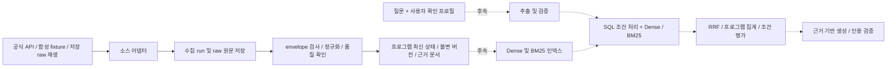

# 초기 아키텍처

상태: **잠정 설계 + 최소 수집 기반 구현**. 실데이터 미확보, 기준일 2026-10-16. 개인 대상 청년·고용·주거·복지 정보 안내가 목표이며 공식 자격 심사·신청 대행·전국 완전성을 제공하지 않는다. 기업/창업 지원, 추가 소스, UI, 검색·생성·reranking은 이번 구현에서 제외했다.

## 경계와 흐름

실선의 수집·저장 경로와 별도의 최소 연령/AND/OR 순수 함수를 구현했다. 점선 검색·생성 흐름은 설계다. API 서버를 빈 상태로 추가하지 않았다. 한 프로세스 CLI로 검증한 뒤 FastAPI를 도입한다.

## 기술 결정과 재검토 조건

| 선택 | 이유 / 도입 시점 / 재검토 |
|---|---|
| Python 3.12 + uv + lock | 현재 설치된 3.12.9 사용. 지원 범위 3.11/3.12, 실제 검증은 Windows 3.12만. 의존성 재현을 위해 `uv.lock` 커밋. Python 3.11·Linux는 CI 추가 때 검증 |
| SQLAlchemy 2 + psycopg 3 | 지금 구현. 동일 Core/ORM 계약으로 PostgreSQL과 오프라인 SQLite 테스트 사용. SQLite 결과만으로 JSONB/pgvector를 검증했다고 주장하지 않음 |
| PostgreSQL 16 + pgvector 0.8.0 | Docker 로컬 기반 및 Alembic extension 구현. 원문·정책·근거를 함께 관리. 재현 가능한 이미지 태그 사용; 운영 전 지원 버전·이미지 보안과 digest pin 검토 |
| Alembic | 지금 구현. frozen 초기 DDL, upgrade/downgrade 및 schema drift 검사. 실행 시 `create_all`로 스키마를 우회하지 않음 |
| Pydantic 2 / settings | envelope/정규화/config 계약. 알려진 필드와 실제 변이를 구별하고 비밀 repr을 차단 |
| HTTPX | timeout·MockTransport를 가진 작은 HTTP 경계. source별 요청 계약을 코드에 고정 |
| FastAPI | 프로필/검색 응답 계약이 정해진 다음 단계. 이번 의존성·빈 서버 없음 |
| OpenAI Python SDK / gpt-4o-mini | 생성 단계에만 도입. 공급 키와 base URL의 호환 endpoint/모델 권한 확인이 선행. 현 단계 설치·호출 없음. 개발 모델 선택과 별개 |
| BAAI/bge-m3 dense | 검색 실험 단계 후보. dense 1024차원, learned sparse와 ColBERT는 도입하지 않음 |
| Kiwi + rank_bm25 BM25Okapi | 후속 초기 소규모 코퍼스용 lexical 선택. 한국어 토큰화를 명시하고 버전/사전을 고정 |
| RRF | 후속. 서로 다른 raw similarity/BM25 점수를 직접 더하지 않고 순위를 결합 |
| pytest / Ruff | 지금 도입. 기본 suite는 외부 네트워크·유료 호출·대형 모델 제외 |
| Streamlit | 검색/생성 평가 후 데모 단계. 개인정보 최소화와 불확실성 표현을 먼저 검증 |

[SQLAlchemy psycopg 문서](https://docs.sqlalchemy.org/en/20/dialects/postgresql.html#module-sqlalchemy.dialects.postgresql.psycopg), [Alembic](https://alembic.sqlalchemy.org/en/latest/tutorial.html), [HTTPX timeout](https://www.python-httpx.org/advanced/timeouts/), [uv lock/sync](https://docs.astral.sh/uv/concepts/projects/sync/)를 참고했다. 설치된 버전과 실제 검사는 [verification.md](verification.md)에 기록한다. 미래 기술은 현재 환경 호환성을 입증한 상태가 아니다.

## 최소 스키마와 근거

**실응답으로 검증하지 않은 provisional schema**다. 보조금24 목록의 공식 명세와 합성 fixture가 근거이며 범용 정책 모델이 아니다.

| 테이블 | 역할 및 핵심 계약 |
|---|---|
| `ingestion_run` | source, fixture/live 종류, normalizer 버전, 요청 범위/페이지 크기, 시작/종료, 기대/수집/거부/변경 건수, 상태, 오류 코드, 원본 replay run |
| `raw_response` | run+요청 page unique, 수집 시각, endpoint, 비밀 없는 query, 최종 HTTP 상태, 정확한 body bytes, SHA256. raw는 파싱 성공 여부와 무관하게 보존 |
| `program` | 내부 UUID, `(source,dataset_kind,source_record_id)` unique, 이름, 현재 revision/내용 해시/정규화 JSONB, 마지막 관측 raw와 레코드 위치, index_pending |
| `program_version` | 내부 UUID, program+revision unique, normalizer 버전, 정규화 JSONB, 해당 raw ID와 레코드 위치, 수집 시각. A→B→A도 별도 revision |
| `search_document` | version+field unique, 원문 필드 텍스트, raw JSON pointer, 시작/끝 offset. 이번에는 필드별 문서만 만들고 토큰 청킹·임베딩은 후속 |

`ProgramData`는 source ID·이름, 소관기관·분야·사용자구분, 대상/혜택/목적/선정기준/신청기간/방법 원문, URL과 확인 상태, 원본 수정일시, 필드 evidence, 품질 문제를 가진다. 결측은 null이며 빈 문자열과 원본 필드 부재의 차이는 raw로 복구한다. 지리 범위는 목록에서 직접 확인할 수 없으므로 null이다. 기관 이름으로 지역을 추정하지 않는다. 원본 날짜 형식과 의미가 확인되지 않아 `수정일시`는 text로 보존한다.

`eligibility_status=unresolved`, `application_availability=unknown`이 현재 값이다. `공식 URL`은 원본 `상세조회URL`만 저장하며 문법 유효성 외에는 검증하지 않았으므로 `url_status=unverified`다. 누락 URL을 만들지 않는다. 외부 redirect·host 공식성·현재 접근 상태 검증을 거친 뒤에만 사용자에게 검증된 링크라고 표현한다. 조건·신청기간을 목록 텍스트에서 자동 구조화하지 않는다.

정규화 evidence는 필드→`source_field/json_pointer`다. version과 결합하면 모든 문서에서 raw까지 추적된다. 후속 추출 조건은 `version_id, document_id, source_field, span, validation_status, reviewer, validated_at, applicable_year`를 반드시 연결한다. 이번에는 조건 테이블·사용자 테이블·vector 컬럼을 만들지 않았다. 유사 이름의 타 소스 레코드는 합치지 않고 검증된 연결 테이블을 후속 설계한다.

## 모듈 입출력

| 모듈 | 계약 |
|---|---|
| `gov24.py` | `SourceAdapter.fetch_page(page,page_size) -> Response(body:bytes,status:int)`; Gov24 HTTP/Fixture 어댑터; `parse_page -> Page`; `normalize(record,index) -> ProgramData`; business hash |
| `ingestion.py` | `ingest(engine,adapter,dataset_kind,page_size,max_pages,replay_of) -> report dict`; 영속 run 상태와 카운터, 페이지 단위 load; ReplayAdapter는 저장 raw만 읽음 |
| `db.py` | 다섯 테이블, UUID/UTC 생성, SQLAlchemy 엔진. 엔진 파라미터 로그 숨김 |
| `domain.py` | JSON 계약과 provisional normalizer identity. schema 변경 때 normalizer 버전도 변경 |
| `eligibility.py` | 검증된 연령 범위 평가와 삼값 AND/OR; source 규칙 추출이나 프로필 해석 없음 |
| `config.py`, `cli.py` | 비밀 없는 실행 결과, `.env`/환경변수 설정. 명령 `fixture`, `live`, `replay`. 미완료 exit 2, 완료 exit 0 |

후속 외부 경계는 구현 전에 계약부터 검증한다. `EmbeddingProvider.encode(texts,model_revision)->vectors+model metadata`는 dimension·유한값을 확인하고 오프라인 fake로 대체한다. `Retriever.search(query,allowed_ids,k,snapshot)->ranked document IDs+rank+source`는 DB binding만 사용한다. `GenerationClient.generate(question,confirmed_profile,evidence,evaluation_date)->claims+evidence IDs+usage`는 gpt-4o-mini만 요청한다. `EligibilityEvaluator.evaluate(validated condition tree,confirmed facts,date)->condition results+evidence+unknown reasons`는 순수 Python이다. 지금은 빈 클래스/일반 plugin 프레임워크를 만들지 않는다.

## 수집·실패·변경 처리

HTTP는 connect/pool 5초, read/write 20초, 최대 3회 시도다. transport 오류와 429/500/502/503/504만 재시도하며 1·2초 지수 backoff와 Retry-After 중 큰 값을 적용한다. Retry-After가 30초를 넘으면 일찍 재시도하지 않고 최종 응답을 기록해 중단한다. redirect는 따르지 않는다. 키·요청 전체 URL·예외 본문을 로그에 남기지 않는다. run별 최대 페이지/크기와 실제 API 한도는 별개다. 여러 run의 총 호출량을 제어하는 계정 예산·스케줄러는 live 운영 전 추가한다.

raw를 먼저 commit한 뒤 envelope·pagination을 검증하고 페이지 전체를 별도 트랜잭션으로 적재한다. currentCount/실제 개수, page/perPage, total/match count 일관성, 중간 빈 페이지와 중복 서비스ID를 확인한다. 필수 ID/이름 문제는 거부 건수와 위치를 기록한다. optional 필드 타입 문제는 null과 quality_issues로 보존하고 사람이 후속 확인한다. 출처별 모호한 문구는 그대로 남긴다. 모든 raw를 읽어 재정규화할 수 있다.

성공은 수집 범위의 기대 건수를 고유 ID로 확보하고 거부가 없는 경우다. 표본/page cap, 실패 페이지, count 변동, 중복·잘못된 레코드는 전체 수집 완료로 간주하지 않는다. `completed`, `partial`, `failed`, `running`으로 구분한다. 프로세스 강제 종료 또는 DB 자체 장애는 `running`과 남은 raw로 복구할 수 있으나 자동 run 복구는 미구현이다. 응답 중 재시도한 각 attempt는 별도 저장하지 않고 최종 응답만 저장한다. HTTP body/오류 응답에 제공기관이 비밀 값을 반사할 가능성이 있으므로 raw는 비공개 DB에 두며 외부 fixture로 내보내기 전 비밀을 검토한다.

내용 해시는 record에서 `조회수`, `등록일시`, `수정일시`만 제외하고 normalizer 버전과 함께 계산한다. 이 타임스탬프들은 원문과 최신 관측 데이터에 남긴다. 그 외 알 수 없는 필드 변화는 보수적으로 내용 변경으로 처리한다. 동일 내용은 last_seen/raw 관측만 갱신하고 새 revision/문서를 만들지 않는다. 내용 변화는 새 revision/문서를 만들며 index_pending을 설정한다. 아직 검색 인덱스 worker가 없으므로 이 플래그는 해제하지 않는다. 향후 문서·임베딩·BM25 갱신 성공을 원자적으로 확인한 뒤 해제한다.

누락된 프로그램을 삭제하거나 종료 처리하는 로직은 없다. 제한 표본/실패 pagination은 미관측일 뿐이다. 완전 수집에서 미관측해도 검토 후보일 뿐이며 소스가 명시한 폐지/종료 근거 또는 재확인된 상세 상태가 있어야 confirmed removal을 기록한다. 근거와 검토 이력을 남기고 논리 상태 변경을 우선한다. 초기 loader는 소스/종류당 **단일 writer** 운영 규칙이다. DB unique는 중복을 방지하지만 동시 writer의 충돌 재시도/잠금은 미구현이다.

## 자격 평가와 사용자 정보

프로필은 사용자 확인 facts와 LLM 추출 interpretations를 분리한다. 초기 후보는 연령/범위·거주 시군구·취업 상태·필요한 가구 구성·소득 맥락·관심사다. 필요한 필드만 요청하며 주민등록번호·정확한 주소는 수집하지 않는다. 질문에서 추출한 추정은 확인 전 hard filter로 쓰지 않는다. 프로필 저장은 이번 범위 밖이며 후속 기본값은 세션 한정이다.

| 연산 | satisfied | not_satisfied | needs_confirmation |
|---|---|---|---|
| AND | 모든 자식 충족 | 하나 이상 불충족 | 나머지 경우 |
| OR | 하나 이상 충족 | 모든 자식 불충족 | 나머지 경우 |

빈 조건 목록은 확인 필요다. 중첩 AND/OR를 유지하고 각 자식 결과·근거를 함께 제시한다. 예외 관계의 의미가 확인되지 않았으면 조건 tree를 확정하지 않고 해당 subtree를 확인 필요로 둔다. 전부 충족이어도 **표현된 검증 조건에 한정된 결과**이며 누락된 조건/행정 심사까지 충족한 것으로 결론 내리지 않는다.

현재 연령 함수는 포함 경계 최소/최대와 `user_confirmed`, `rule_validated`를 요구한다. 없거나 유효하지 않은 값은 확인 필요다. 나이 계산 기준(만 나이/특정 기준일)이 확인된 규칙에만 사용한다. 나이 범위 프로필은 후속에서 전체 포함/불포함/경계 교차를 구분해야 하며 지금 함수를 임의 대표값에 적용하지 않는다.

소득은 개인/가구, 월/연, 세전/세후, 화폐, 산정 정의, 적용 연도·가구원 수와 검증된 기준중위소득 표가 일치해야 비교한다. 소득인정액과 단순 급여를 같은 값으로 취급하지 않는다. 기준표나 의미·단위가 미확인이면 확인 필요다. 이번에는 소득 evaluator를 구현하지 않았다.

신청 상태 `open/upcoming/closed/ongoing/unknown`은 자격과 별도이며 명시된 접수 기간과 평가일로만 계산한다. ongoing은 출처에 상시 신청이 명시된 경우에 한정한다. 시행일·수집일·지원주기로 접수 상태를 추론하지 않는다. UTC로 수집 시각을 저장하고 time-sensitive 평가는 명시적 날짜와 `ZoneInfo('Asia/Seoul')`를 사용한다. Windows IANA timezone 사용을 위해 tzdata를 설치한다.

## 후속 검색·생성 설계

먼저 소스/종류(fixture 제외)·최신 revision과 사용자 확인된 hard constraint를 SQL에서 처리한다. 예컨대 검증된 지역 범위만 사용하고 region unknown은 유지한다. 조건이 불확실하거나 OR/예외 일부라면 SQL에서 제거하지 않고 재순위/조건 평가로 보낸다. SQL의 NULL을 불충족으로 취급하지 않는다. hard constraint와 관심사/관련성 신호를 구분하며 실제 validation 근거 없이는 filter를 활성화하지 않는다.

Kiwi로 원문/질문에 동일한 정규화·형태소 분해를 적용한다. Unicode NFC, 공백 정리, 라틴 소문자화는 검색용 사본에만 적용하고 명사·동사/형용사 어간·숫자/단위를 보존한다. 초기에는 임의의 법률 용어 치환·동의어 확장 없이 명칭/합성어를 보완하는 원문 어절 토큰을 함께 사용한다. token/POS 정책·사용자 사전·Kiwi 버전을 snapshot manifest에 고정한다. 작은 코퍼스에는 [rank_bm25](https://github.com/dorianbrown/rank_bm25)의 BM25Okapi를 메모리에서 사용하고 corpus snapshot별 전체 index를 재작성해 원자 교체한다. IDF가 corpus에 의존하므로 문서 하나 변경 시에도 전체 rebuild한다. 메모리·rebuild 시간이 커지면 실제 측정으로 검색 엔진 전환을 판단한다. [Kiwi](https://github.com/bab2min/kiwipiepy) Windows 호환성은 후속 단계에서 실설치 검증한다. PostgreSQL built-in FTS나 BGE-M3 learned sparse를 BM25라고 부르지 않는다.

BGE-M3는 [공식 모델 카드](https://huggingface.co/BAAI/bge-m3) 기준 dense 1024차원, 최대 8192 토큰이다. [파일 목록](https://huggingface.co/BAAI/bge-m3/tree/main)의 `pytorch_model.bin`은 약 2.27GB이며 전체 cache는 tokenizer와 사용 경로에 따라 더 크다. CPU FP32 추론은 메모리와 latency를 측정해야 한다. 현재 가용 RAM 약 6GB에서 긴 입력/큰 batch를 가정하지 않는다. GPU가 있어도 CUDA/PyTorch 호환성과 여유 VRAM을 별도 확인한다. 자동 startup/default tests 다운로드는 금지하고 명시적 준비 명령과 `local_files_only` 사용을 설계한다. 실제 권장 길이·batch·p95 latency는 아직 측정하지 않았다.

임베딩에는 model ID, 고정 revision SHA, dimension=1024, dtype/정규화, text/chunk 버전, 생성일을 저장한다. 모델/revision/차원·tokenizer·청킹 변경은 전체 re-embedding 및 snapshot 분리를 요구한다. 처음에는 pgvector exact cosine search로 평가하고 corpus 규모/latency가 요구할 때 HNSW를 검토한다. 아직 vector 컬럼이 없으므로 향후 migration에서 `vector(1024)`와 model metadata를 함께 도입한다.

RRF는 제안값 `k=60`으로 `sum(1/(k+rank))`를 계산하고 누락 retriever rank는 기여하지 않는다. 동일 문서는 retriever별 한 번만 센다. chunk별 fusion 후 program current version으로 묶고 최고 문서 순위 및 제한된 supporting chunks를 제시한다. 긴 정책의 chunk 수만으로 점수가 불어나는 것을 막도록 program 집계 방식은 라벨 평가로 결정한다. 다른 소스의 비슷한 이름은 자동 dedup하지 않는다.

결과 없음은 확보 범위 내 결과 없음으로 표현한다. 관련 문서만 있고 자격 근거가 없으면 조건 확인을 요청하고, 프로필 불완전이면 필요한 필드만 묻는다. 생성 입력에는 문서를 untrusted evidence로 전달하며 원문 내 명령을 따르지 않는다. evidence ID와 허용 URL 목록을 넘기고 출력 claims를 그 목록과 검사한다. 생성기는 자유 SQL이나 새 URL을 만들 수 없다. 응답에는 프로그램명·관련성 근거·조건별 결과·확인 필요 항목·신청기간/방법·검증된 URL·데이터 갱신 정보를 포함한다. 누락 값은 미확인으로 명시한다.

OpenAI SDK는 [공식 Python 문서](https://developers.openai.com/api/reference/python)를 참고하되 실제 설치 버전으로 API signature를 검증한 뒤 도입한다. [gpt-4o-mini 공식 페이지](https://developers.openai.com/api/docs/models/gpt-4o-mini)에 deprecation 표기가 관측되었다. 사용자가 지정한 모델은 유지하고, 후속 생성 착수 전 공급 endpoint의 실제 지원/종료 공지/계정 권한을 확인한다. 자동 대체 모델·OpenAI embedding endpoint를 가정하지 않는다. 현재 키가 없으므로 계정 권한은 미검증이다.

## 단계와 도입 제한

1. 현재: 조사·문서·fixture 수집·raw 재생·영속 이력·최소 조건 테스트.
2. 승인 키 확보 후 소량 live 표본, 상세/조건 의미 검증, 스키마 revision, 범위 선별.
3. 동결 corpus·한글 질의 라벨·BM25/dense/RRF 비교와 검증된 조건 evaluator 확대.
4. gpt-4o-mini 권한 확인 후 근거 생성·citation 검증, FastAPI, 다음으로 Streamlit 데모.
5. 평가 근거가 있을 때 reranker 및 추가 공식 소스. 기업 지원은 별도 범위 합의 후.

LangGraph/다중 에이전트 런타임은 장기 상태 전이와 복구 복잡성이 실제로 생길 때만 검토한다. 별도 graph DB는 관계 질의가 PostgreSQL로 충족되지 않는 측정 근거가 있을 때, Kafka는 지속적인 고처리량 이벤트 필요 때, Airflow는 다중 의존 수집 DAG 운영이 필요할 때, Kubernetes는 여러 서비스의 배포/가용성 요구가 확인될 때 검토한다. 현재에는 도입하지 않는다.
